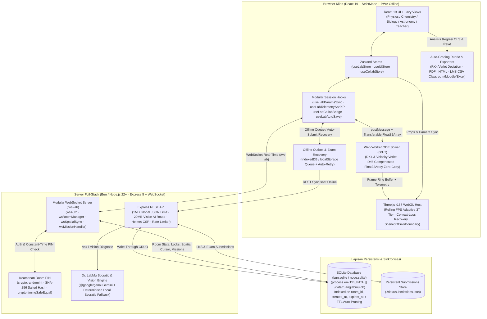

# Arsitektur Sistem RuangLABmu

Dokumen ini menjelaskan arsitektur end-to-end **RuangLABmu** (*Integrated 3D Virtual Science Laboratory, Socratic AI Mentor & Real-Time Collaborative LMS*), yang dirancang untuk performa deterministik 60Hz, ketahanan perangkat sekolah 3T (*Tertinggal, Terdepan, dan Terluar*), kolaborasi multi-pengguna ber-PIN kriptografis, serta persistensi SQLite & Offline PWA.

---

## 1. Diagram Alir Sistem End-to-End (Mermaid)

---

## 2. Aliran Data Antar-Lapisan

### 2.1 React UI (Zustand) ↔ Modular Session Hooks
- **Manajemen State Terpisah (`src/stores/`)**:
  - `useLabStore`: Menyimpan parameter fisika/kimia/biologi/astronomi, rekaman data eksperimen (`ExperimentRecord[]`), dan waktu simulasi.
  - `useUIStore`: Mengatur tema visual (*Light / Sepia / Dark*), *Lite 3T Mode*, *Projector Mode 1.5x*, serta laci analitik.
  - `useCollabStore`: Mengelola status Room PIN, daftar peserta, kursor spasial 3D, *parameter mutex lock*, dan tantangan sampel misterius.
- **Komposisi Hook (`src/hooks/useLabSession.ts`)**:
  - `useLabParamsSync.ts`: Mengelola perubahan parameter, normalisasi snapshot lintas versi (`normalizeLegacyPhysicsParams`), dan fitur *Undo/Redo*.
  - `useLabTelemetryAndXP.ts`: Menghitung metrik domain secara *memoized* dan mendistribusikan XP gamifikasi.
  - `useLabCollabBridge.ts`: Menjembatani event WebSocket, *mutex parameter lock*, serta sinkronisasi kamera 3D pengajar.
  - `useLabAutoSave.ts`: Menyimpan draf sesi ke penyimpanan lokal dan memulihkan antrean ujian offline (`ruanglabmu_failed_exam_submissions_v1`) secara otomatis saat koneksi kembali `online`.

### 2.2 Web Worker (RK4 / Velocity Verlet) ↔ Three.js WebGL (Adaptive 3T Tier)
- **Solver Numerik Terisolasi (`src/workers/simulationWorker.ts`)**:
  - Menjalankan integrasi persamaan diferensial **Runge-Kutta Orde-4 (RK4)** dan **Velocity Verlet** pada frekuensi 60Hz dengan kompensasi *timer drift* berbasis `performance.now()`.
  - Dilengkapi batas keamanan `MAX_STEP_FRAMES = 3600` (60 detik waktu simulasi kontinu), blok `try/catch` terstruktur pada `startLoop()`, dan pengiriman frame via `Float32Array` *transferable buffer* (`zero-copy`).
- **Ketahanan WebGL & Perangkat 3T (`src/utils/threeStudioHost.ts`, `src/utils/threeStudioKit.ts`, `src/components/common/Scene3DErrorBoundary.tsx`)**:
  - **Context-Loss Recovery**: Menangani event `webglcontextlost` (`event.preventDefault()`) dan `webglcontextrestored` untuk menginisialisasi ulang *renderer*, *geometries*, dan *materials* tanpa me-reload halaman.
  - **Rolling FPS Window Monitor**: Memantau jendela waktu bergulir 2 detik. Jika rata-rata FPS turun di bawah **30 FPS** selama > 2 detik (atau saat *Lite 3T Mode* aktif), sistem otomatis menurunkan `renderer.setPixelRatio(1)`, menonaktifkan *shadow map* berat, dan menampilkan lencana status performa di HUD (`data-testid="hud-performance-tier-badge"`).
  - **Modular Scene Stages (`src/components/scenes/`)**: Setiap kanvas domain (`PhysicsScene3D`, `ChemistryScene3D`, `BiologyScene3D`, `AstronomyScene3D`) mendelegasikan konstruksi aparatus 3D dan *update loop* ke modul khusus (`physicsCoreStage.ts`, `chemistryCoreStage.ts`, `biologyCoreStage.ts`, `*Rigs.ts`).

### 2.3 Express + WebSocket PIN Room ↔ SQLite Persistence (`bun:sqlite` / `node:sqlite`)
- **Dekomposisi WebSocket (`server/ws/`)**:
  - `wsAuth.ts`: Validasi skema pesan, pembatasan ukuran *payload* (64 KB), *token-bucket rate limiting*, dan verifikasi PIN guru menggunakan `crypto.timingSafeEqual`.
  - `wsRoomManager.ts`: Siklus hidup room, *join/leave*, pembuatan Room dengan PIN acak kriptografis (`crypto.randomInt(100000, 1000000)`), dan *broadcast*.
  - `wsSpatialSync.ts`: Sinkronisasi kursor laser 3D, pose kamera pengajar, dan *mutex parameter lock*.
  - `wsMissionHandler.ts`: Distribusi misi kustom dan penguncian instrumen siswa (*teacher freeze*).
- **Persistensi SQLite (`server/state/sqliteAdapter.ts` & `server/state/labServerState.ts`)**:
  - Menggunakan `bun:sqlite` secara native di runtime Bun dengan *fallback* otomatis ke `node:sqlite` (`DatabaseSync`) di Node.js 22+.
  - Menyimpan seluruh koleksi (`active_lab_rooms`, `session_snapshots`, `parameter_locks`, `experiment_records`, `group_tasks`, `collab_notes`, `student_roster`, `notifications`) di `process.env.DB_PATH || './data/ruanglabmu.db'`.
  - Dilengkapi indeks pada `room_id`, `created_at`, dan `expires_at`, serta pemangkasan otomatis (*TTL auto-pruning*) untuk kunci parameter dan notifikasi yang kedaluwarsa.

### 2.4 Engine Auto-Grading Rubrik LMS (`src/utils/academicReportExporter.ts`)
- Membandingkan nilai eksperimen/regresi siswa (`observedValue`, `rSquared`, `relativeUncertaintyPct`, `trialsRecorded`) terhadap nilai teoretis solver numerik **RK4 / Velocity Verlet** (`evaluateTheoreticalSolverRubricGrade`).
- Menghasilkan skor terukur `0–100`, persentase deviasi (`percentDeviation`), predikat, dan umpan balik diagnostik otomatis, serta mendukung ekspor CSV satu klik untuk **Google Classroom, Moodle, dan Microsoft Excel**.
